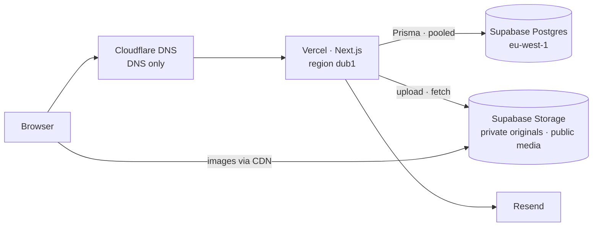

# Matthew Pearce — Portfolio

A full stack portfolio built as a working product rather than a static page. Every word and image on the public site comes from the database and is managed through a custom admin portal.

**Live:** [mattcreates.co.za](https://mattcreates.co.za)

**Status:** the admin portal is complete. The public site is being built on top of it: the themed layout, Home, Side Quests, the Quest Board, case study pages and a custom 404 are done; the Chronicle, contact form and SEO are next.

## Stack

| Layer           | Choice                                                                                                                  |
| --------------- | ----------------------------------------------------------------------------------------------------------------------- |
| Framework       | Next.js (App Router, Cache Components) · TypeScript                                                                     |
| Styling         | Tailwind CSS · hand-built components (no UI library)                                                                    |
| Database        | PostgreSQL on Supabase · Prisma ORM                                                                                     |
| Auth            | Better Auth — owner-only magic-link sign-in                                                                             |
| Validation      | Zod — one schema per module, shared by forms, server actions and the API                                                |
| Rich text       | Tiptap, stored as allow-listed JSON                                                                                     |
| Media           | Supabase Storage (AVIF/WebP variants made with sharp, metadata stripped)                                                |
| Background jobs | None yet; a durable queue (Inngest) arrives with SMS alerts                                                             |
| Email / SMS     | Resend · SMS Portal                                                                                                     |
| Rate limiting   | Upstash Redis (hashed keys; fails open)                                                                                 |
| Edge            | Vercel hosting · Cloudflare DNS, Turnstile                                                                              |
| Testing         | Vitest (incl. access sweeps over every server action and API route) · GitHub Actions (builds against a seeded Postgres) |

## Public site

Themed as an "Adventurer's Ledger": parchment, leather, wax seals, with a **Plain view** toggle in the header that strips the decoration for a quick skim. Motion respects `prefers-reduced-motion`.

| Page                  | What it shows                                                                                                                                 |
| --------------------- | --------------------------------------------------------------------------------------------------------------------------------------------- |
| `/` Home              | Hero, character sheet, experience bar (from the work history), skills by category, featured case studies, recent jobs, contact call to action |
| `/about` Side Quests  | Hobbies with covers, stats and stories; filter by hobby                                                                                       |
| `/quests` Quest Board | Every published case study; filter by type and technology                                                                                     |
| `/quests/[slug]`      | One case study: briefing, problem, constraints, approach + diagram, hardest problem, outcome, lessons                                         |
| 404                   | A themed "off the map" page                                                                                                                   |

Pages are pre-rendered from the database and refresh when the content changes in the admin.

## Admin portal

`/admin` is where every piece of public content is written. It is built with plain React, Tailwind and native HTML (`<dialog>`, `<form>`, server actions), with no component library.

| Section       | What it edits                                                                                        |
| ------------- | ---------------------------------------------------------------------------------------------------- |
| Pages & copy  | Every line of site text, plain or rich                                                               |
| Quests        | Case studies: summary, stack, links, chapter, diagram and seven rich-text sections                   |
| Side quests   | Hobbies: cover image, tagline, attribute, stats and story                                            |
| Chronicle     | Work history: dates, summary, ordered highlights, stack                                              |
| Skills        | The skill tree, by category, edited inline                                                           |
| Settings      | Open to work, role type, GitHub and LinkedIn links                                                   |
| Ravens        | Contact messages: unread/archived, reply in your own mail app                                        |
| Commendations | LinkedIn recommendations, each linking back to the original                                          |
| Media vault   | Display images (profile photo, screenshots, diagrams): AVIF/WebP copies, metadata stripped, alt text |

Every save follows the same path: server action (check the owner's session → validate with Zod) → service (business rules) → repository (Prisma) → refresh only the affected cache tags. Lists can be sorted and reordered by drag or keyboard; rich text is cleaned against an allow-list on the server, so only known formatting and safe links are stored.

## How content is served

Public pages call module services directly; the reads run inside `'use cache'` functions tagged with `cacheTag()`, so visitors get pre-rendered pages. A save expires only the affected tags (`src/lib/cache.ts`, tag names in `src/lib/cache-tags.ts`).

The same services back a read-only REST API for outside clients (published content as JSON, CDN-cached; errors are RFC 9457 `application/problem+json` with a request id):

| Endpoint                       | Returns                                                                       |
| ------------------------------ | ----------------------------------------------------------------------------- |
| `GET /api/v1/quests`           | Published case studies as cards (`?status=all` for the owner: drafts too)     |
| `GET /api/v1/quests/{slug}`    | One case study: every section as Tiptap JSON, chapter, diagram, previous/next |
| `GET /api/v1/side-quests`      | Published side quests (`?status=all` for the owner)                           |
| `GET /api/v1/side-quests/{id}` | One side quest                                                                |

## Getting started

Requirements: Node 22+, a PostgreSQL database (Supabase free tier works).

```bash
npm install
cp .env.example .env      # fill in DATABASE_URL and DIRECT_URL at minimum
npm run db:migrate        # create tables
npm run db:seed           # load starter content
npm run dev
```

To sign in to the admin (`/admin`), set `BETTER_AUTH_SECRET` and put your email in `ADMIN_EMAILS`. Without `RESEND_API_KEY`, the magic link is printed in the terminal instead of emailed. Image uploads need the `SUPABASE_*` storage variables; rate limiting uses `UPSTASH_*` and is skipped when they are unset. Only allow-listed emails can sign in — visitors never need an account.

| Script                                | What it does                                        |
| ------------------------------------- | --------------------------------------------------- |
| `npm run dev`                         | Start the dev server                                |
| `npm run build`                       | Generate the Prisma client and build for production |
| `npm run lint` / `typecheck` / `test` | Quality checks (all run in CI)                      |
| `npm run db:migrate`                  | Create/apply migrations in development              |
| `npm run db:deploy`                   | Apply migrations in production                      |
| `npm run db:seed`                     | Upsert starter content (safe to re-run)             |
| `npm run db:studio`                   | Browse the database                                 |

## Project structure

A **modular monolith**: one deployable Next.js app, with the backend split into business modules.

```
prisma/                 schema, migrations, seed
src/
├── app/                routes only (thin): (site)/ public pages, admin/, sign-in/
│   └── api/v1/         REST controllers for outside clients (read-only today)
├── modules/            one folder per business area
│   └── side-quests/
│       ├── index.ts                 the module's public API
│       ├── side-quests.actions.ts   controller for admin forms ('use server')
│       ├── side-quests.service.ts   business rules
│       ├── side-quests.repository.ts  Prisma queries only (data access layer)
│       ├── side-quests.schema.ts    Zod contracts, shared with the browser
│       └── *.test.ts
│   (also: quests, chronicle, skills, commendations, content, settings, media, messages, auth)
├── components/         presentation: site/ (public), admin/
├── db/                 Prisma client (pooled) + Prisma error translation
└── lib/                shared utilities: http/ (REST helpers), errors, cache, validation/, rich text
```

Rules, enforced by ESLint (`no-restricted-imports`):

- From outside a module, import only its `index.ts`, `*.actions` or `*.schema`. Services, repositories and helpers stay private.
- Only repositories touch the Prisma client.
- Modules talk to each other in-process through those public APIs (e.g. quests asks `@/modules/chronicle` whether a chapter exists).

| Request            | Path                                                                                        |
| ------------------ | ------------------------------------------------------------------------------------------- |
| Page load (read)   | Browser → Server Component → module service → repository → Postgres                         |
| Admin form (write) | Client Component → server action (auth, Zod) → service → repository → Postgres              |
| External client    | HTTP → `app/api/v1/**/route.ts` (auth, Zod, status codes) → service → repository → Postgres |

## Architecture



One Next.js app. Public pages render from the database inside cached functions; admin saves refresh only the affected cache tags.

### Key decisions

| Decision                                                                      | Why                                                                                                                                                                     |
| ----------------------------------------------------------------------------- | ----------------------------------------------------------------------------------------------------------------------------------------------------------------------- |
| One app (modular monolith), not separate admin/API services                   | One developer, low traffic: one deploy and one auth system. Module boundaries mean a busy module can be extracted later without untangling it.                          |
| Server actions for the site's own forms; REST (`/api/v1`) for outside clients | The standard Next.js split: no HTTP hop to ourselves, and a versioned, documented API where something external needs one. Both call the same services.                  |
| Supabase as plain Postgres, accessed only through Prisma                      | One typed data path. The public Data API is locked (RLS on, no policies, privileges revoked).                                                                           |
| Sign-in is for the owner only (Better Auth magic link; email allow-list)      | Visitors never need an account, so no personal data is collected. No passwords stored. Checked in the proxy, the admin layout, every server action and every API route. |
| No UI component library; admin components written in plain React + Tailwind   | Every component is understood and owned; native `<dialog>` and form elements cover accessibility.                                                                       |
| Rich text stored as Tiptap JSON and cleaned against an allow-list on save     | The public renderer only ever sees known nodes and safe links, so no raw HTML is ever injected.                                                                         |
| Database-driven content with tag-based caching                                | Edit without redeploying, yet pages load like a static site and survive a slow database.                                                                                |
| Media in Supabase Storage: private originals, public resized copies           | Same project as the database and well within the free plan for a few display images; metadata (incl. GPS) stripped before anything is public.                           |
| No background-job service yet; a queue only once SMS needs retries            | No infrastructure before a workload needs it.                                                                                                                           |
| Migrations run during production builds only                                  | Schema and code ship together; previews never change the live schema. Migrations stay additive.                                                                         |
| Functions pinned to `dub1`, next to the database                              | Saves ~75 ms on every database round trip.                                                                                                                              |
| One shared database while pre-launch                                          | No real data yet; revisit before launch.                                                                                                                                |

## Licence

Code is MIT licensed. Written content, photographs and artwork are © Matthew Pearce and not covered by the licence.
