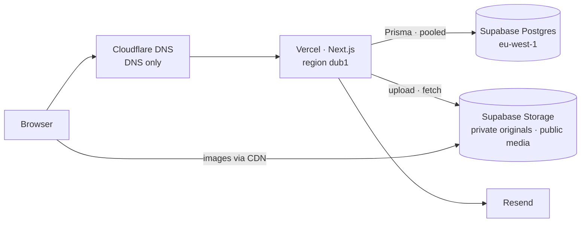

# Matthew Pearce — Portfolio

A full stack portfolio built as a working product rather than a static page. Every word and image on the public site comes from the database and is managed through a custom admin portal.

**Live:** [mattcreates.co.za](https://mattcreates.co.za)

## Stack

| Layer           | Choice                                                                   |
| --------------- | ------------------------------------------------------------------------ |
| Framework       | Next.js (App Router, Cache Components) · TypeScript                      |
| Styling         | Tailwind CSS · hand-built components (no UI library)                     |
| Database        | PostgreSQL on Supabase · Prisma ORM                                      |
| Auth            | Better Auth — owner-only sign-in (magic link, GitHub)                    |
| Validation      | Zod — one schema per entity, shared by forms and server actions          |
| Rich text       | Tiptap, stored as allow-listed JSON                                      |
| Media           | Supabase Storage (AVIF/WebP variants made with sharp, metadata stripped) |
| Background jobs | Next.js `after()`; a durable queue arrives with SMS                      |
| Email / SMS     | Resend · SMS Portal                                                      |
| Edge            | Vercel hosting · Cloudflare DNS, Turnstile                               |
| Testing         | Vitest · GitHub Actions                                                  |

## Admin portal

`/admin` is where every piece of public content is written. It is built with plain React, Tailwind and native HTML (`<dialog>`, `<form>`, server actions), with no component library.

| Section       | What it edits                                                                                        |
| ------------- | ---------------------------------------------------------------------------------------------------- |
| Pages & copy  | Every line of site text, plain or rich                                                               |
| Quests        | Case studies: summary, stack, links, chapter, diagram and seven rich-text sections                   |
| Side quests   | Hobbies: cover image, tagline, attribute, stats and story                                            |
| Chronicle     | Work history: dates, summary, ordered highlights, stack                                              |
| Skills        | The skill tree, by category, edited inline                                                           |
| Commendations | LinkedIn recommendations, each linking back to the original                                          |
| Media vault   | Display images (profile photo, screenshots, diagrams): AVIF/WebP copies, metadata stripped, alt text |

Every save follows the same path: check the owner's session → validate with Zod → write with Prisma → refresh only the affected cache tags. Lists can be sorted and reordered by drag or keyboard; rich text is cleaned against an allow-list on the server, so only known formatting and safe links are stored.

## How content is served

Public pages read from the database inside `'use cache'` functions tagged with `cacheTag()`. Visitors get pre-rendered pages; saving in the admin calls `updateTag()` so only the affected pages refresh. See `src/lib/cache-tags.ts`.

## Getting started

Requirements: Node 22+, a PostgreSQL database (Supabase free tier works).

```bash
npm install
cp .env.example .env      # fill in DATABASE_URL and DIRECT_URL at minimum
npm run db:migrate        # create tables
npm run db:seed           # load starter content
npm run dev
```

To sign in to the admin (`/admin`), set `BETTER_AUTH_SECRET` and put your email in `ADMIN_EMAILS`. Without `RESEND_API_KEY`, the magic link is printed in the terminal instead of emailed. Only allow-listed emails can sign in — visitors never need an account.

| Script                                | What it does                                        |
| ------------------------------------- | --------------------------------------------------- |
| `npm run dev`                         | Start the dev server                                |
| `npm run build`                       | Generate the Prisma client and build for production |
| `npm run lint` / `typecheck` / `test` | Quality checks (all run in CI)                      |
| `npm run db:migrate`                  | Create/apply migrations in development              |
| `npm run db:deploy`                   | Apply migrations in production                      |
| `npm run db:seed`                     | Upsert starter content (safe to re-run)             |
| `npm run db:studio`                   | Browse the database                                 |

## Project structure

```
prisma/            schema, migrations, seed
src/app/           routes — public site, /admin, API handlers
src/components/    UI components (admin/ today, site/ with the public pages)
src/server/        server-only code: database, auth, queries
src/lib/           shared, framework-free code: Zod schemas, rich-text allow-list, cache tags
```

## Architecture



One Next.js app. Public pages render from the database inside cached functions; admin saves refresh only the affected cache tags.

### Key decisions

| Decision                                                                          | Why                                                                                                                                                    |
| --------------------------------------------------------------------------------- | ------------------------------------------------------------------------------------------------------------------------------------------------------ |
| One app (modular monolith), not separate admin/API services                       | One developer, low traffic: one deploy and one auth system. Split when a second app exists.                                                            |
| Supabase as plain Postgres, accessed only through Prisma                          | One typed data path. The public Data API is locked (RLS on, no policies, privileges revoked).                                                          |
| Sign-in is for the owner only (Better Auth: magic link, GitHub; email allow-list) | Visitors never need an account, so no personal data is collected. No passwords stored. Checked in the proxy, the admin layout and every server action. |
| No UI component library; admin components written in plain React + Tailwind       | Every component is understood and owned; native `<dialog>` and form elements cover accessibility.                                                      |
| Rich text stored as Tiptap JSON and cleaned against an allow-list on save         | The public renderer only ever sees known nodes and safe links, so no raw HTML is ever injected.                                                        |
| Database-driven content with tag-based caching                                    | Edit without redeploying, yet pages load like a static site and survive a slow database.                                                               |
| Media in Supabase Storage: private originals, public resized copies               | Same project as the database and well within the free plan for a few display images; metadata (incl. GPS) stripped before anything is public.          |
| `after()` for background work; a queue only once SMS needs retries                | No infrastructure before a workload needs it.                                                                                                          |
| Migrations run during production builds only                                      | Schema and code ship together; previews never change the live schema. Migrations stay additive.                                                        |
| Functions pinned to `dub1`, next to the database                                  | Saves ~75 ms on every database round trip.                                                                                                             |
| One shared database while pre-launch                                              | No real data yet; revisit before launch.                                                                                                               |

## Licence

Code is MIT licensed. Written content, photographs and artwork are © Matthew Pearce and not covered by the licence.
